# Executive Summary — Dependency Security & CI Gate

**Overall Risk Rating:** **HIGH (Baseline)** -> **LOW (Post-Remediation PR #1, pending merge)**  
*Rationale:* The `main` branch baseline (`b319129`) contains 21 blocking vulnerabilities (1 Critical, 20 High) in core HTTP, authentication, and utility dependencies. Upgrading those 5 dependencies in PR #1 (`dbcfa10`) eliminated all 49 detected vulnerabilities and passed the automated CI quality gate (`exit 0`).

## Finding Counts by Severity
| Baseline vs. Remediated | Critical | High | Medium | Low | Total | CI Gate |
|---|---:|---:|---:|---:|---:|---|
| Baseline (`main` — Run `44021949406`) | 1 | 20 | 21 | 7 | 49 | **FAIL** (`exit 1`) |
| Remediated (PR #1 — Run `44024570812`) | 0 | 0 | 0 | 0 | 0 | **PASS** (`exit 0`) |

```mermaid
xychart-beta
    title "Baseline vs. Remediated Vulnerabilities (Trivy 0.66.0)"
    x-axis ["Critical", "High", "Medium", "Low"]
    y-axis "Findings" 0 --> 25
    bar [1, 20, 21, 7]
    bar [0, 0, 0, 0]
```

## Business Impact
- **Service availability & outages**: Multiple High/Critical flaws in `express` transitive packages (`body-parser`, `path-to-regexp`, `qs`) and `axios` allow attackers to crash or hang Node.js services with crafted requests.
- **Data exposure & unauthorized access**: Outdated `axios` and `jsonwebtoken` versions expose applications to server-side request forgery (SSRF), proxy credential leakage, and weak JWT key handling.
- **Release governance**: The fail-closed CI quality gate now blocks vulnerable dependency changes automatically before reaching production, while preserving audit artifacts on every run.

## Action Plan
- **Within 1 week**:
  1. Review and merge PR [#1](https://github.com/DerbSwag/fusion-devsecops-takehome/pull/1) so `main` carries the remediated dependencies.
  2. Enable branch protection on `main` requiring the `security-scan` status check to pass before merge.
- **Within 1 month**:
  1. Add scheduled weekly Trivy scans (`schedule` cron) to catch newly disclosed CVEs between code changes.
  2. Expand CI coverage beyond dependency SCA to include SAST and secret scanning.

## Management Decisions / Resources Requested
- Approve branch-protection enforcement on `main` requiring `security-scan` to pass for all Pull Requests.
- Allocate ~2–4 engineering hours per month for dependency updates and SAST/secret-scanning onboarding.

**Evidence:** FAIL Run `44021949406` (`b319129`, `trivy-json-44021949406-1`) | PASS Run `44024570812` (`dbcfa10`, `trivy-json-44024570812-1`).
