# Executive Summary — Dependency Security & CI Gate

## 1. Security Risk Overview

- **Historical Baseline Risk:** **HIGH** — The initial repository baseline contained **49 known vulnerabilities** (1 Critical, 20 High, 21 Medium, 7 Low) across core web, HTTP, and authentication dependencies.
- **Post-Remediation Dependency-Scan Risk:** **LOW (within assessed dependency scope)** — Upgrading the five direct dependencies resolved all 49 detected vulnerabilities (`0` findings), verified across both PR remediation and post-merge `main` CI checks.
- **Overall Application Security Risk:** **Not fully assessed** — Automated scanning currently covers third-party package dependencies only; application source code, secrets, and runtime infrastructure have not yet been scanned.

## 2. Findings by Severity

| Scan Stage | Critical | High | Medium | Low | Total | CI Quality Gate |
|---|---:|---:|---:|---:|---:|---|
| Baseline (`main`, initial state) | 1 | 20 | 21 | 7 | **49** | **FAIL** (`exit 1`) |
| Remediated (PR #1 & Post-Merge `main`) | 0 | 0 | 0 | 0 | **0** | **PASS** (`exit 0`) |

```mermaid
xychart-beta
    title "Vulnerabilities Before vs. After Remediation (Trivy 0.66.0)"
    x-axis ["Critical", "High", "Medium", "Low"]
    y-axis "Finding Count" 0 --> 25
    bar "Baseline (49)" [1, 20, 21, 7]
    bar "Remediated (0)" [0, 0, 0, 0]
```

## 3. Business Impact

- **Service Availability:** Outdated web-framework and HTTP client packages could allow malformed external requests to slow down or crash Node.js services, risking unplanned downtime.
- **Data Exposure & Unauthorized Access:** Known flaws in HTTP request and token-handling libraries could expose outbound credentials or weaken authentication checks if triggered in production code. No confirmed exploitation has been observed, as only dependency manifests are present in this sample.
- **Release Governance:** The automated CI gate now blocks High/Critical dependency vulnerabilities and fails closed on scanner errors, though branch protection on `main` is **not yet active** to enforce this check before every merge.

## 4. Remediation Status

- **Completed:** Upgraded all five vulnerable direct dependencies (resolving all 49 direct and transitive findings), hardened the CI quality gate with fail-closed target validation and 14 passing unit tests, and merged both remediation and hardening PRs into `main` with passing post-merge CI verification.

## 5. Next Steps — 1 Week / 1 Month

- **Within 1 Week (Owner: DevSecOps / Repository Admin):** Enable GitHub branch protection on `main` requiring the `security-scan` check to pass before merge; review and refresh any remaining pre-merge status notes in repository documentation.
- **Within 1 Month (Owner: Engineering / DevSecOps):** Add scheduled weekly dependency scans to detect newly disclosed vulnerabilities between commits, and onboard SAST and secret-scanning checks to close current coverage gaps.

## 6. Management Decisions / Resources Requested

- **Policy Approval:** Approve mandatory `security-scan` branch-protection enforcement on `main` (requires repository admin action).
- **Engineering Capacity:** Allocate ~2–4 engineering hours per month for ongoing dependency updates and SAST/secret-scanning integration.

## 7. Evidence Reference

- **Historical FAIL (`main`):** Run [`44021949406`](https://github.com/DerbSwag/fusion-devsecops-takehome/actions/runs/44021949406) (`b319129`) | **Historical PASS (PR #1):** Run [`44024570812`](https://github.com/DerbSwag/fusion-devsecops-takehome/actions/runs/44024570812) (`dbcfa10`) | **Latest Post-Merge `main` (PR #2):** Run [`44051483315`](https://github.com/DerbSwag/fusion-devsecops-takehome/actions/runs/44051483315) (`61609d4`, artifact `14314006995`). Scope limited to `sample-app/package-lock.json`.
